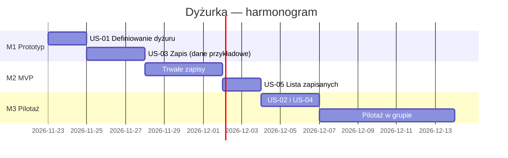

# PRD: Dyżurka — zapisy na konsultacje prowadzącego

| | |
|---|---|
| **Wersja** | 1.0 (przykład wzorcowy do warsztatu, sesja 5) |
| **Właściciel** | dr Anna Nowak (prowadząca, właścicielka produktu) |
| **Status** | Do recenzji |
| **Ostatnia zmiana** | 19.11.2026 |

> **Trzy zdania (wejście):** Studenci umawiają się na konsultacje mailowo, a ja tonę w korespondencji
> i nie wiem, kto przyjdzie i z czym. Chcę, żeby student sam wybrał wolny termin i od razu napisał temat.
> Sukces: w tygodniu dyżurów dostaję co najwyżej dwa maile organizacyjne, a nie piętnaście.

---

## 1. Kontekst i problem

Konsultacje umawiane są mailowo. Jedno spotkanie kosztuje średnio 3–4 wiadomości („czy mogę przyjść?”,
„o której?”, „a jednak nie mogę”). W tygodniu przed kolokwium prowadząca dostaje ok. 15 takich maili,
pod drzwiami tworzy się kolejka, a o temacie rozmowy dowiaduje się dopiero na miejscu.

**Dlaczego teraz:** zbliża się sesja zimowa; pilotaż w jednej grupie przed sesją pozwoli zebrać uwagi.

## 2. Cele i mierniki sukcesu

| ID | Cel | Miernik | Wartość docelowa |
|---|---|---|---|
| C1 | Student zapisuje się bez pisania maila | czas od otwarcia linku do potwierdzenia | < 1 minuta |
| C2 | Prowadząca wie, kto przyjdzie i z czym | odsetek zapisów z wpisanym tematem | 100% (pole wymagane) |
| C3 | Mniej korespondencji organizacyjnej | maile organizacyjne w tygodniu dyżurów | ≤ 2 (dziś ok. 15) |
| C4 | Zero podwójnych rezerwacji | liczba slotów zajętych przez dwie osoby | 0 |

## 3. Użytkownicy i persony

- **P1 · Student — „Ola”**, II rok, studia niestacjonarne. Zapisuje się z telefonu, w przerwie w pracy.
  Potrzebuje: zobaczyć wolne terminy w 10 sekund i nie zakładać żadnego konta.
- **P2 · Prowadząca — „dr Nowak”**, 4 grupy, dyżur we wtorki 12:00–14:00. Pracuje na laptopie.
  Potrzebuje: listy osób na dany dzień z tematami, możliwości odwołania dyżuru.
- **P3 · Sekretariat** — w MVP **nie jest użytkownikiem** (patrz: poza zakresem).

## 4. Zakres i poza zakresem

**W zakresie (MVP):** dyżury jednej prowadzącej · sloty o stałej długości · zapis z tematem ·
anulowanie zapisu przez studenta · lista zapisanych dla prowadzącej · odwołanie dyżuru.

**Poza zakresem (non-goals) — świadomie NIE robimy:**
- logowania kontem uczelnianym i integracji z USOS / Moodle / Teams (brak dostępu przez API — polityka uczelni),
- powiadomień mailowych i SMS,
- obsługi wielu prowadzących i sal,
- statystyk i raportów dla dziekanatu.

## 5. Epiki i historie użytkownika

Format historii: **Jako** [rola] **chcę** [czynność], **aby** [korzyść].
Kryteria akceptacji: **Zakładając, że** [stan] · **gdy** [działanie] · **wtedy** [wynik].

### E1 · Ogłaszanie dyżurów (prowadząca)

**US-01 · Definiuję termin dyżuru** — *Must* · rozmiar: S
Jako prowadząca chcę ustawić dzień, godziny i długość slotu, aby studenci widzieli wolne miejsca.
- Zakładając, że ustawiam wtorek 12:00–14:00 i slot 15 min, gdy zapisuję dyżur, wtedy powstaje 8 slotów.
- Zakładając, że godzina końca jest wcześniejsza niż początku, gdy zapisuję, wtedy widzę komunikat błędu i nic się nie zapisuje.

**US-02 · Odwołuję dyżur** — *Should* · rozmiar: S · zależy od: US-01, US-03
Jako prowadząca chcę odwołać dyżur z podaniem powodu, aby zapisani studenci nie przyszli na próżno.
- Zakładając, że na dyżur zapisały się 3 osoby, gdy go odwołuję, wtedy przy każdym ich zapisie widać „Odwołany: [powód]”.

### E2 · Zapisy (student)

**US-03 · Zapisuję się na wolny slot** — *Must* · rozmiar: M · zależy od: US-01
Jako student chcę wybrać wolny slot i wpisać imię oraz temat, aby nie pisać maila do prowadzącej.
- Zakładając, że slot 12:15 jest wolny, gdy wpisuję imię i temat i klikam „Zapisz”, wtedy widzę potwierdzenie z kodem anulowania.
- Zakładając, że slot 12:15 jest zajęty, wtedy nie da się go wybrać.
- Zakładając, że pole tematu jest puste lub ma ponad 200 znaków, gdy klikam „Zapisz”, wtedy widzę komunikat i zapis nie powstaje.
- Zakładając, że dwie osoby wybierają ten sam slot w tej samej chwili, wtedy zapisuje się tylko pierwsza, a druga widzi „Ten termin został właśnie zajęty”.

**US-04 · Anuluję swój zapis** — *Should* · rozmiar: S · zależy od: US-03
Jako student chcę anulować zapis kodem z potwierdzenia, aby zwolnić miejsce innym.
- Zakładając, że mam kod anulowania, gdy go wpisuję, wtedy slot znów jest wolny.

### E3 · Przegląd zapisów (prowadząca)

**US-05 · Widzę listę zapisanych** — *Must* · rozmiar: S · zależy od: US-03
Jako prowadząca chcę zobaczyć listę osób na dany dyżur z tematami, aby przygotować się do rozmów.
- Zakładając, że na wtorek zapisały się 4 osoby, gdy otwieram panel, wtedy widzę 4 wiersze w kolejności godzin.

**US-06 · Eksportuję listę do CSV** — *Could* · rozmiar: S · zależy od: US-05
Jako prowadząca chcę pobrać listę jako CSV, aby wkleić ją do notatek w Excelu.

**US-07 · Widzę statystykę tematów** — *Won't (nie w tej wersji)*
Jako prowadząca chcę wiedzieć, o co studenci pytają najczęściej, aby poprawić materiały.

## 6. Priorytety (MoSCoW)

| Must (MVP nie istnieje bez tego) | Should (ważne, ale MVP przeżyje) | Could (miło mieć) | Won't (nie tym razem) |
|---|---|---|---|
| US-01, US-03, US-05 | US-02, US-04 | US-06 | US-07 |

Reguła kontrolna: historie *Must* to nie więcej niż ok. 60% szacowanego wysiłku.

## 7. Wymagania niefunkcjonalne

- **Urządzenia:** działa na telefonie (ekran od 360 px) i na laptopie.
- **Dostępność:** kontrast zgodny z WCAG 2.1 AA, każde pole formularza ma etykietę, obsługa z klawiatury.
- **Dane osobowe (RODO):** minimalizacja — tylko imię i temat, bez numeru albumu i maila; zapisy usuwane 30 dni po dyżurze.
- **Wydajność:** lista slotów pojawia się w mniej niż 1 s.
- **Język:** interfejs po polsku.

## 8. UI/UX

**Przepływ studenta:** link z Moodle → lista slotów → formularz → potwierdzenie z kodem.

**Ekrany:**
- **E-1 Lista slotów** (student): data dyżuru, sloty jako przyciski; zajęte wyszarzone.
- **E-2 Formularz zapisu:** imię, temat (licznik znaków 0/200), przycisk „Zapisz”.
- **E-3 Potwierdzenie:** godzina, temat, kod anulowania (duży, do skopiowania).
- **E-4 Panel prowadzącej:** lista zapisanych, przycisk „Odwołaj dyżur”.

**Stany, o których łatwo zapomnieć:**
- pusty: „Wszystkie terminy zajęte. Następny dyżur: wtorek 26.11.”,
- błąd: „Ten termin został właśnie zajęty — wybierz inny”,
- ładowanie: szkielet listy zamiast pustej strony.

**Makieta tekstowa E-1:**

```
┌──────────────────────────────────────┐
│ Dyżur dr Nowak · wtorek 26.11        │
│ 12:00 [zajęte]   12:15 [ wolne ]     │
│ 12:30 [ wolne ]  12:45 [zajęte]      │
│ ...                                  │
└──────────────────────────────────────┘
```

## 9. Zależności, założenia i ryzyka

**Zależności między historiami:** US-01 → US-03 → (US-04, US-05) → US-06; US-02 wymaga US-01 i US-03.

**Zależności zewnętrzne:** miejsce publikacji linku (Moodle lub Teams — wklejamy ręcznie); hosting aplikacji (do decyzji).

**Założenia:** studenci mają link; prowadząca ma jeden stały dyżur w tygodniu.

**Ryzyka:**

| Ryzyko | Skutek | Co robimy |
|---|---|---|
| Zapisy z wielu telefonów muszą trafiać w jedno miejsce | aplikacja w jednym pliku HTML nie wystarczy | decyzja techniczna: gdzie mieszkają dane (sesja 6) |
| Dane osobowe w niewłaściwym miejscu | naruszenie RODO | minimalizacja danych, usuwanie po 30 dniach |
| Nikt nie użyje | brak efektu | pilotaż w jednej grupie, link w Moodle |

## 10. Harmonogram i kamienie milowe

| Kamień | Termin | Zawiera | Kryterium ukończenia |
|---|---|---|---|
| M1 · Klikalny prototyp | tydzień 1 | US-01, US-03 na danych przykładowych | prowadząca przechodzi przepływ bez instrukcji |
| M2 · MVP | tydzień 2–3 | wszystkie *Must*, trwałe zapisy | 5 testowych zapisów z różnych telefonów |
| M3 · Pilotaż | tydzień 4–5 | *Should*, poprawki | jedna grupa, ≤ 2 maile organizacyjne w tygodniu |



## 11. Otwarte pytania

1. Gdzie fizycznie zapisują się dane, żeby widziały je wszystkie telefony? (decyzja techniczna — sesja 6)
2. Czy imię wystarczy, czy prowadząca potrzebuje też grupy zajęciowej?
3. Czy dyżury powtarzają się automatycznie co tydzień, czy prowadząca dodaje każdy?

## 12. Słownik

- **Dyżur** — stały termin konsultacji prowadzącej (np. wtorek 12:00–14:00).
- **Slot** — pojedynczy termin w dyżurze (np. 12:15–12:30), przeznaczony dla jednej osoby.
- **Kod anulowania** — krótki kod pokazany po zapisie, pozwalający odwołać zapis bez konta.

---

### Historia zmian

| Wersja | Data | Kto | Co |
|---|---|---|---|
| 1.0 | 19.11.2026 | A. Nowak + agent | pierwsza wersja z wywiadu |
